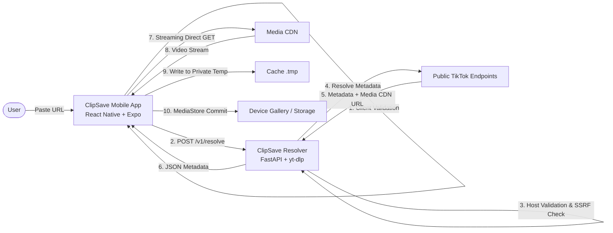

# ClipSave 🎬

**ClipSave** is an Android-first, privacy-focused media downloader built with **React Native + Expo** and a hardened **Python FastAPI** resolver backend. It allows users to resolve and download public TikTok videos they own or have permission to save, featuring verifiable progress, zero telemetry, and strong security defenses.

---

## Key Highlights

- **Truthful Progress:** Displays real byte transfer progress (`bytesDownloaded / totalBytes`). No hardcoded or fake percentage spinners.
- **Zero Telemetry & Tracking:** No advertising IDs, third-party analytics SDKs, or background tracking beacons.
- **Strict SSRF & Input Defenses:** Multi-layer hostname allowlist, DNS pre-flight verification against RFC 1918 / loopback / cloud metadata IPs, and bounded concurrency.
- **Local-First History:** Saved items and preferences remain on your device. Separate controls for clearing history records vs. deleting media files from device storage.
- **Graceful Expo Go & Native Build Separation:** Runs in Expo Go for UI, URL validation, and mock resolver mode; documents exact requirements for Android Share Target and MediaStore integration in compiled builds.

---

## Architecture Overview



---

## Quick Start Guide

### Prerequisites
- **Node.js** >= 20.0 (Node `v24.18.0` tested)
- **npm** (v11.16.0 tested)
- **Python** >= 3.12 (Python `3.13.14` tested)
- **Docker** (optional, for containerized backend)

---

### 1. Start the Backend Resolver

```bash
# Navigate to project root
cd "d:\Skills\Tiktok Downloader"

# Set up Python virtual environment & install dependencies
python -m venv backend/.venv
.\backend\.venv\Scripts\pip install -r backend\requirements.txt

# Start the resolver service on port 8080
.\backend\.venv\Scripts\uvicorn app.main:app --app-dir backend --host 127.0.0.1 --port 8080 --reload
```
*Health check probe:* `curl http://127.0.0.1:8080/healthz`

*Alternatively, run with Docker Compose:*
```bash
docker compose up -d --build
```

---

### 2. Start the Mobile Client

```bash
# Install npm dependencies
npm install

# Run the Expo development server
npx expo start
```
*Scan the terminal QR code using the **Expo Go** app on your Android phone.*

---

## Running the Automated Test Suites

### Mobile Frontend Tests (TypeScript Strict Check & Jest)
```bash
# Typecheck entire codebase in strict mode
npm run typecheck

# Run Jest unit and integration tests (33 tests)
npm test
```

### Backend Resolver Tests (Pytest)
```bash
# Run Pytest suite for SSRF, rate limiting, and contract tests (15 tests)
.\backend\.venv\Scripts\pytest -v backend\tests
```

### Mocked Load & Concurrency Benchmark
```bash
# Run local concurrency load test against mock resolver
.\backend\.venv\Scripts\python backend\load_test.py
```

---

## Runtime Boundaries: Expo Go vs. Development Build

| Feature | Expo Go | Development Build / APK |
| :--- | :--- | :--- |
| **URL Input, Paste, & Validation** | Fully Supported | Fully Supported |
| **Mock Resolver Mode** | Fully Supported | Fully Supported |
| **Remote Resolver Integration** | Fully Supported | Fully Supported |
| **Foreground Streaming Download** | Fully Supported | Fully Supported |
| **History & Storage Controls** | Fully Supported | Fully Supported |
| **Light / Dark Themes** | Fully Supported | Fully Supported |
| **Android Share Target (`SEND` intent)** | Unsupported (Expo Go limitation) | Fully Supported via `app.json` config plugin |
| **Public MediaStore Gallery Saving** | Fallback to System Share | Fully Supported via `expo-media-library` |

*For complete details, see [`docs/EXPO_GO_LIMITATIONS.md`](docs/EXPO_GO_LIMITATIONS.md).*

---

## Building Native Android Development Build

To test native Android Share Target intent filters and direct MediaStore insertion:
```bash
# Generate native Android project with config plugins
npx expo prebuild --platform android

# Compile and run development build on connected Android device/emulator
npx expo run:android
```

---

## Project Documentation Index

- [`docs/ARCHITECTURE.md`](docs/ARCHITECTURE.md): Architectural decisions, state machine, and data flow.
- [`docs/REPOSITORY_AUDIT.md`](docs/REPOSITORY_AUDIT.md): Initial inventory, system runtimes, and port audit.
- [`docs/EXPO_GO_LIMITATIONS.md`](docs/EXPO_GO_LIMITATIONS.md): Feature-by-feature runtime compatibility matrix.
- [`docs/REQUIREMENTS_TRACEABILITY.md`](docs/REQUIREMENTS_TRACEABILITY.md): Requirements mapped to implementation and tests.
- [`docs/PRIVACY.md`](docs/PRIVACY.md): Data flow disclosure and local retention policy.
- [`docs/DEPENDENCIES.md`](docs/DEPENDENCIES.md): Pinned packages, licenses, and rationale.
- [`docs/THREAT_MODEL.md`](docs/THREAT_MODEL.md): STRIDE threat evaluation and OWASP alignments.
- [`docs/TEST_PLAN.md`](docs/TEST_PLAN.md): Multi-perspective test strategy and scenario matrix.
- [`docs/TEST_REPORT.md`](docs/TEST_REPORT.md): Complete execution outcomes, passed tests, and un-run tests.
- [`docs/RUNBOOK.md`](docs/RUNBOOK.md): Triage procedures for outages, rate limits, and updates.
- [`docs/OPERATIONS.md`](docs/OPERATIONS.md): Service health checks, resource ceilings, and staged updates.
- [`docs/DEPLOYMENT.md`](docs/DEPLOYMENT.md): Container and development deployment steps.
- [`docs/BUGS_AND_RISKS.md`](docs/BUGS_AND_RISKS.md): Known limitations and accepted risks.
- [`docs/INCIDENT_RESPONSE.md`](docs/INCIDENT_RESPONSE.md): Severity definitions and containment protocol.
- [`CHANGELOG.md`](CHANGELOG.md): Semantic version history and feature changelog.

---

## Legal & Compliance Notice

ClipSave is an independent open-source utility and is not affiliated with, endorsed, sponsored, or associated with TikTok, ByteDance, or any of their affiliates. ClipSave is intended solely for saving media the user owns or has received express authorization to download. ClipSave does not bypass private account restrictions, login walls, or digital rights management controls.
