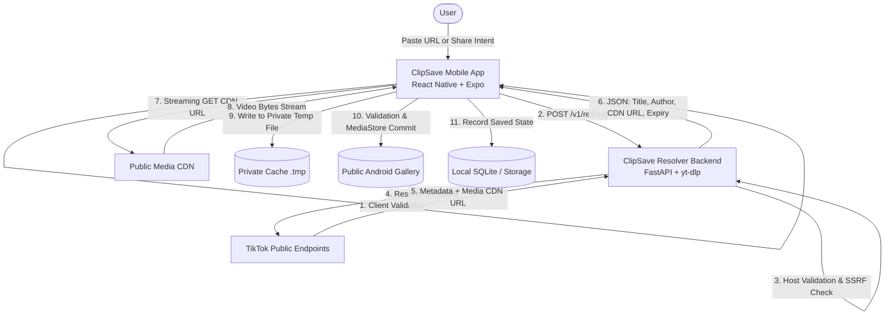
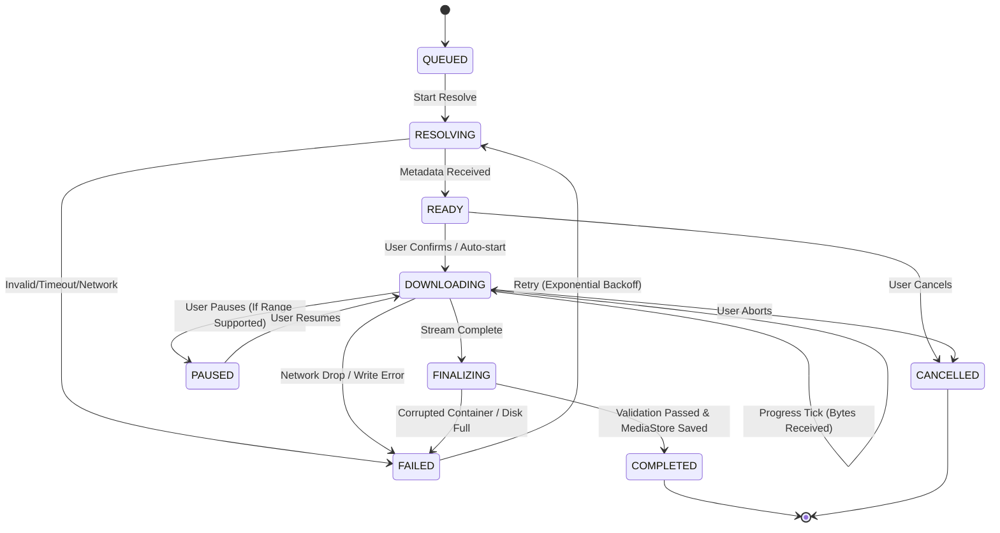

# ARCHITECTURE: ClipSave

**Version:** 1.0.0  
**Date:** 2026-10-26  
**Status:** Approved Baseline  

---

## 1. System Overview

ClipSave is an Android-first, privacy-focused media downloader designed to resolve and save user-owned or authorized videos from TikTok with verifiable progress, zero telemetry, and strong security protections.

The system is composed of two primary components:
1. **ClipSave Mobile Client:** A React Native + Expo application built with TypeScript and Expo Router.
2. **ClipSave Resolver Backend:** A lightweight, hardened FastAPI service utilizing `yt-dlp` to safely resolve public TikTok links into direct media URLs.

---

## 2. Architectural Decisions & Rationale

### ADR-01: Why React Native + Expo
- **Decision:** Use React Native with Expo SDK 52 and Expo Router.
- **Rationale:** 
  - Rapid, clean component composition with TypeScript strict mode.
  - Native filesystem, media library, and clipboard primitives through verified Expo modules (`expo-file-system`, `expo-media-library`, `expo-clipboard`).
  - Prebuild capabilities allow config plugins for native Android Share Target intent filters and scoped storage permissions without abandoning managed workflow tooling.
  - Cross-platform foundation while strictly optimizing for Android-first consumer UX.

### ADR-02: Isolated Backend Resolver vs. Client-Side Extraction
- **Decision:** Utilize an external Python FastAPI resolver service running `yt-dlp` rather than running extraction logic on-device.
- **Rationale:**
  - TikTok frequently changes API responses, DOM structure, and anti-scraping techniques. Maintaining an extractor in native JS or bundling Python/Wasm inside a mobile app creates bloat (>50MB), battery drain, and requires app store review delays for every platform patch.
  - The backend resolver is stateless, hardened, and strictly limited to resolving metadata and CDN URLs. **It never proxies, downloads, or stores video bytes**, preserving user privacy, minimizing bandwidth, and avoiding copyright caching issues.

### ADR-03: Direct Streaming Download Architecture
- **Decision:** The mobile client downloads video streams directly from the CDN to local storage.
- **Rationale:**
  - Relieves the backend of heavy streaming bandwidth and media storage liability.
  - Client streams directly to a private temporary file (`cache/downloads/[jobId].tmp`).
  - Progress is measured directly by listening to real bytes transferred from the HTTP stream.
  - The final file is committed to Android MediaStore (`DCIM/ClipSave` or `Movies/ClipSave`) only upon complete, verified byte delivery.

### ADR-04: State Machine for Download Lifecycle
- **Decision:** Model the download lifecycle as a deterministic, finite state machine (FSM).
- **Valid States:**
  - `QUEUED`: Enqueued in local queue coordinator.
  - `RESOLVING`: Client is fetching metadata from the resolver API.
  - `READY`: Metadata resolved, waiting for user confirmation or automatic start.
  - `DOWNLOADING`: Active HTTP streaming in progress; reporting honest progress.
  - `PAUSED`: User paused (only if byte-range resume is supported by CDN).
  - `FINALIZING`: Verifying byte count, closing stream, moving from temp to public gallery.
  - `COMPLETED`: Media safely saved to gallery, recorded in local history.
  - `FAILED`: Terminal or retryable failure with safe, human-readable error.
  - `CANCELLED`: User aborted; temp file deleted immediately.

---

## 3. Storage & Data Persistence

1. **Local History and Queue:**
   - Managed via SQLite / structured JSON key-value store.
   - Contains: `id`, `sourceUrl` (sanitized), `title`, `author`, `duration`, `thumbnailUrl`, `fileUri`, `fileSizeBytes`, `createdAt`, `status`.
   - Distinguishes between **History Entry** (metadata record) and **Media File** (actual MP4 file in device storage). Deleting a history entry prompts the user whether they also wish to delete the underlying file.

2. **Temporary File Management:**
   - Temp directory: `${FileSystem.cacheDirectory}downloads/`
   - Orphaned temp files older than 24 hours or belonging to jobs not actively downloading are cleaned up on app startup.

3. **Public Media Saving (Android):**
   - Media saved to public `Movies/ClipSave` or `Pictures/ClipSave` collection using scoped storage (`expo-media-library`).
   - Requires only `READ_MEDIA_VIDEO` / scoped media permissions on Android 13+ (no legacy `WRITE_EXTERNAL_STORAGE` needed).

---

## 4. Trust Boundaries & Security Architecture (STRIDE)

| Threat Category | Potential Threat | Mitigation |
| :--- | :--- | :--- |
| **Spoofing** | Attacker impersonates TikTok domain | Strict hostname matching: only `tiktok.com`, `www.tiktok.com`, `vm.tiktok.com`, `vt.tiktok.com`, `m.tiktok.com`. Rejection of lookalike domains, userinfo (`user:pass@host`), and invalid ports. |
| **Tampering** | Incomplete or corrupted video files committed to gallery | Streaming writes to private `.tmp` files. Verification of total bytes and file signature before promoting to gallery. |
| **Repudiation** | User denies downloading unauthorized content | App includes explicit first-use terms and confirmation sheet reminding users they may only download content they own or have authorization to save. |
| **Information Disclosure** | Server logs or client logs leak URLs, query parameters, or CDN tokens | Strict log redaction on backend and client. Query strings and tokens stripped from all log outputs. No analytics SDKs present. |
| **Denial of Service** | Flooding backend with resolve requests or malformed URLs | In-memory token bucket rate limiting (per IP), request body limits (max 10KB), request timeouts (10s), bounded extractor worker pool. |
| **Elevation of Privilege / SSRF** | Attacker inputs `http://169.254.169.254/latest/meta-data` to access cloud host credentials | Pre-flight DNS resolution verification before any HTTP/extractor connection. Private/reserved IP blocks (RFC 1918, link-local, loopback, AWS/GCP metadata) are rejected immediately. Extractor restricted to TikTok only. |

---

## 5. Failure Modes & Recovery

1. **Transient Network Failure During Download:**
   - Download engine attempts up to 3 retries with exponential backoff and jitter for recoverable network breaks (e.g. ECONNRESET, timeout).
   - If server supports `Range` requests, resume from current byte offset. Otherwise, clean restart from 0 bytes.
2. **Expired CDN URL:**
   - TikTok CDN links often include expiry timestamps (`expires=...`). If a download fails with HTTP 403 or 410, the client invokes the resolver once more to obtain a refreshed CDN URL.
3. **Low Storage / Disk Full:**
   - Filesystem write failure catches `ENOSPC`, halts download, deletes temporary file, and presents a clear "Insufficient device storage" error to the user without crashing.
4. **App Killed / Background Process Death:**
   - Active jobs are marked `INTERRUPTED` on startup. The user is presented with a "Resume" or "Restart" action on the Queue screen.
