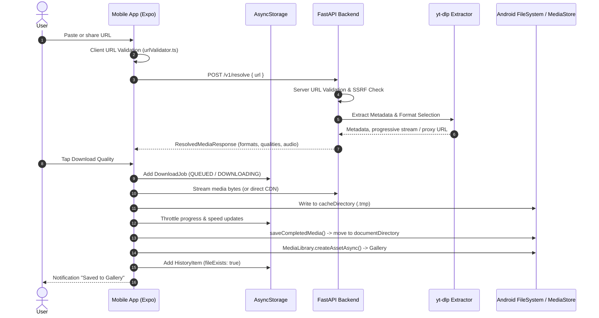

# ClipSave — Complete Repository Inventory & Architecture Audit

**Date:** 2026-10-30  
**Audit Scope:** Repository-Only Static & Dynamic Codebase Analysis  
**Auditor:** Independent Principal Product & Security Engineering Team  

---

## 1. Executive Summary

ClipSave is an Android-first mobile media resolution and download client paired with a stateless Python FastAPI backend. This audit verified the repository structure, code organization, dependency hygiene, and runtime architecture.

Overall, the codebase demonstrates clean modular separation:
- **Mobile Frontend:** Built with React Native, Expo 58, Expo Router, TypeScript, and AsyncStorage. It features a design-token theme system, throttled queue state management, and resilient storage separation.
- **Backend Service:** Built with FastAPI, yt-dlp, and ffmpeg streaming remuxing, featuring layered SSRF defenses, sliding-window rate limiting, and log redaction.
- **Identified Deficiencies:** Ephemeral ngrok tunnel URL leakage in settings defaults, missing "Network & Resolver" settings section in the Accordion UI, and cleartext traffic permission in Android configuration.

---

## 2. Complete Codebase Inventory

### 2.1 Mobile Application (`app/` & `src/`)

| Path | Purpose | Key Responsibilities |
| :--- | :--- | :--- |
| `app/_layout.tsx` | Root Layout | ThemeProvider wrapper, Stack navigator, StatusBar configuration |
| `app/(tabs)/_layout.tsx` | Tab Navigator | Bottom navigation bar with 4 tabs: Home, Queue, History, Settings |
| `app/(tabs)/index.tsx` | Home / Download Screen | URL input, real-time clipboard prompt, live platform detection, preview card, quality selector |
| `app/(tabs)/queue.tsx` | Queue Management Screen | Active, queued, paused, and failed downloads; pause/resume/cancel/retry actions |
| `app/(tabs)/history.tsx` | History Screen | Downloaded media catalog, playback intent trigger, file existence verification, delete options |
| `app/(tabs)/settings.tsx` | Settings Screen | Theme mode, palette, accent color, default quality, concurrency, storage management |
| `app/preview.tsx` | Media Preview Modal | Full-screen video metadata inspector, technical facts, direct download actions |
| `app/about.tsx` | About & Privacy Screen | App version, legal disclaimers, zero-tracking policy, platform limitations |
| `src/components/` (18 files) | Reusable UI Kit | AccordionRow, Badge, BottomSheetMenu, Button, Card, DisclaimerBanner, EmptyState, FadeIn, IconBubble, IconButton, IconLabel, LaunchAnimation, PressableScale, ProgressBar, ScreenHeader, SegmentedControl, TabHeader, TextButton |
| `src/hooks/useQueue.ts` | Reactive State Hook | Subscribes React components to throttled queue store changes |
| `src/services/apiClient.ts` | API Client | Backend communication, timeout handling, SnapDeploy container wake-up trigger |
| `src/services/downloadEngine.ts` | Download Orchestrator | `expo-file-system` DownloadResumable sessions, concurrency semaphore, speed tracking |
| `src/services/mediaManager.ts` | Android MediaStore Manager | Gallery export via `expo-media-library`, temp directory creation, orphaned file cleanup |
| `src/services/mockResolver.ts` | Mock Resolver Fixture | Offline / development deterministic metadata and format options for testing |
| `src/storage/queueStore.ts` | Queue Store | AsyncStorage persistence with 120ms UI notification throttle and process-death recovery |
| `src/storage/historyStore.ts` | History Store | Persistent download history, separating record-only deletion from record+media deletion |
| `src/storage/settingsStore.ts` | Settings Store | Persistent user preferences, memory cache, self-healing migration |
| `src/theme/` (5 files) | Design Tokens | Colors (palettes & accents), motion timings, spacing, typography, ThemeContext |
| `src/utils/` (5 files) | Utilities | `urlValidator.ts`, `filenameSanitizer.ts`, `formatters.ts`, `jobDisplay.ts`, `speedTracker.ts` |
| `src/types/index.ts` | Type Definitions | Domain models (`DownloadJob`, `ResolvedMedia`, `AppSettings`, `HistoryItem`, etc.) |

### 2.2 Backend Resolver Service (`backend/`)

| Path | Purpose | Key Responsibilities |
| :--- | :--- | :--- |
| `backend/app/main.py` | FastAPI Application Entry | Lifespan management, CORS middleware, request tracing, security headers |
| `backend/app/config.py` | Configuration | Pydantic Settings reading environment variables with secure defaults |
| `backend/app/models.py` | Data Contracts | Pydantic schemas: `ResolveRequest`, `ResolvedMediaResponse`, `ErrorResponse` |
| `backend/app/routes/health.py` | Health Probes | Root info (`/`), Liveness (`/healthz`), Readiness (`/readyz`) |
| `backend/app/routes/resolve.py` | Resolution & Streaming | POST `/v1/resolve` (metadata extraction), GET `/v1/stream/{id}` (remuxed proxy) |
| `backend/app/security/url_validation.py` | URL Validation | Strict allowlists for TikTok, YouTube, Instagram, Facebook; path checks |
| `backend/app/security/ssrf.py` | SSRF Defense | Pre-flight DNS resolution, IPv4/IPv6 private & cloud metadata blocklist enforcement |
| `backend/app/security/rate_limit.py` | Abuse Protection | Sliding window IP rate limiter with auto-pruning to prevent memory growth |
| `backend/app/security/logging.py` | Safe Logging | Redaction of query parameters, tokens, and session identifiers in application logs |
| `backend/app/services/extractor.py` | yt-dlp Extraction | Bounded ThreadPoolExecutor, format parsing, sound-first selection, session registry |
| `backend/tests/` (5 files) | Pytest Suite | `test_rate_limit.py`, `test_resolve_api.py`, `test_ssrf.py`, `test_stream_session.py`, `test_url_validation.py` |

---

## 3. Architecture & Runtime Flow Verification

---

## 4. Architectural Analysis & Findings

### 4.1 Positive Architectural Patterns
1. **Clean Decoupling:** The mobile client remains functional in mock mode without external dependencies.
2. **Process Death Reconciliation:** `loadQueueFromStorage` detects in-flight jobs left in `DOWNLOADING` or `FINALIZING` state on app crash/termination and reconciles them to `FAILED` (with `isRetryable: true`), preventing stuck states.
3. **Throttled State Updates:** `queueStore.ts` uses a 120ms notification throttle and 1000ms AsyncStorage debounce, preventing UI freezes during high-speed byte streaming.
4. **Data Loss Protection:** `historyStore.ts` strictly separates `removeHistoryEntryOnly` from `deleteHistoryEntryAndFile`, preventing accidental media deletion.
5. **Defense-in-Depth SSRF:** Both URL syntax validation and socket-level DNS pre-flight verification prevent access to private IP ranges and cloud metadata endpoints (`169.254.169.254`).

### 4.2 Identified Architectural Deficiencies & Inconsistencies
1. **Hardcoded Ephemeral URL in Production Store:**
   - In `src/storage/settingsStore.ts`, `PRODUCTION_BACKEND_URL` was assigned to `NGROK_BACKEND_URL` (`https://ef84-39-62-179-21.ngrok-free.app`), which will cause remote resolution failures once the local tunnel terminates.
2. **Missing UI Setting for Backend URL & Mock Mode:**
   - Although `AppSettings` supports `backendBaseUrl` and `useMockResolver`, the updated settings UI omitted an accordion row for configuring the resolver endpoint and toggling mock resolver mode.
3. **Android Cleartext Traffic Permitted:**
   - `app.json` has `"usesCleartextTraffic": true`. For production release builds, this should be restricted to prevent insecure plaintext HTTP transmission.
4. **Multi-Worker Memory Sharing:**
   - In `backend/Dockerfile`, Uvicorn is invoked with `--workers 2`. In-memory dictionaries (`_stream_sessions` and `_request_history`) are isolated per worker process. In single-container deployments without Redis, running with `--workers 1` ensures session continuity.
