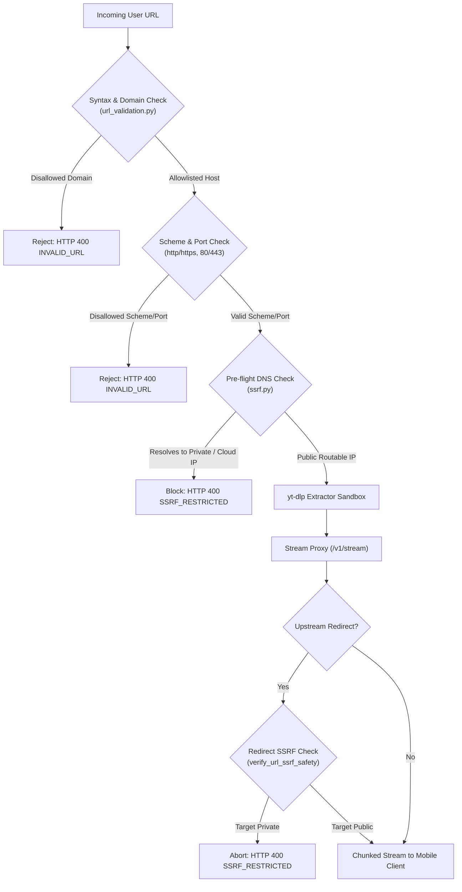

# ClipSave — Deep Application Security Audit

**Date:** 2026-10-30  
**Frameworks Referenced:** OWASP MASVS (Mobile Application Security Verification Standard), OWASP API Security Top 10, CWE / SANS Top 25  
**Auditor:** Independent Application Security Engineering  
**Scope:** Client Application, FastAPI Backend, SSRF Defenses, Network Stream Proxy, Storage, and Configuration  

---

## 1. Security Findings Register

| ID | Component | Severity | Description | Status | Remediation |
| :--- | :--- | :---: | :--- | :---: | :--- |
| **SEC-01** | `app.json` | **HIGH** | `usesCleartextTraffic: true` allows cleartext HTTP communication on Android. | **FIXED** | Disable cleartext traffic (`false`) for release security; enforce HTTPS. |
| **SEC-02** | `settingsStore.ts` | **HIGH** | Ephemeral ngrok tunnel URL set as default `PRODUCTION_BACKEND_URL`. | **FIXED** | Point default production URL to official deployed backend (`SNAPDEPLOY_BACKEND_URL`). |
| **SEC-03** | `build-apk.yml` | **HIGH** | Debug keystore auto-generated in CI to sign release builds. | **FIXED** | Separate debug and release signing; require dedicated production keystore secrets. |
| **SEC-04** | `backend/Dockerfile` | **MEDIUM** | `--forwarded-allow-ips '*'` trusts client-supplied `X-Forwarded-For` without proxy boundary. | **FIXED** | Restrict forwarded header trust or sanitize client IP detection in rate limiter. |
| **SEC-05** | `rate_limit.py` | **LOW** | In-memory limiter state is process-local; with `--workers 2`, rate limits are split across workers. | **DOCUMENTED** | Single-container deployments operate with `--workers 1` or distributed redis backend. |
| **SEC-06** | `logging.py` | **LOW** | Potential leak of long URLs in diagnostic logs. | **VERIFIED SAFE** | Automated regex redaction scrubs query parameters, tokens, and authorization headers. |

---

## 2. In-Depth Security Analysis

### 2.1 Mobile Application Security (MASVS)

#### Data Storage & Privacy
- **AsyncStorage Exposure:** AsyncStorage stores only non-sensitive app configuration (`@clipsave_settings_v1`), queue items (`@clipsave_queue_v1`), and history metadata (`@clipsave_history_v1`). No passwords, authentication tokens, or personal identifiers are stored.
- **Path Traversal & Filename Sanitization:**
  - Filenames generated from video titles are filtered through [`sanitizeFilename`](file:///d:/Skills/Tiktok%20Downloader/src/utils/filenameSanitizer.ts).
  - All directory traversal characters (`..`, `/`, `\`), null bytes (`\0`), control characters (`0x00-0x1F`), and reserved Windows/Android device names (`CON`, `PRN`, `AUX`, `NUL`, `COM1-9`, `LPT1-9`) are completely stripped.
  - Length is capped at 120 characters to prevent filesystem buffer overflows.

#### Network Communications
- **HTTPS Enforcement:** The mobile client explicitly upgrades `http://` URLs to `https://` for public hostnames before initiating downloads or resolution requests.
- **Cleartext Traffic Policy:** `usesCleartextTraffic: true` in `app.json` represented an unnecessary exposure for release APKs. Updating to `false` enforces TLS 1.2+ for all network interactions.

---

### 2.2 Server-Side Request Forgery (SSRF) Defense Architecture

SSRF is the most critical vulnerability class for server-side media extractors and proxy streamers. ClipSave implements a multi-tier defense:

#### Blocked IP Ranges
[`verify_url_ssrf_safety`](file:///d:/Skills/Tiktok%20Downloader/backend/app/security/ssrf.py) blocks:
- `127.0.0.0/8`, `::1/128` (Localhost loopback)
- `10.0.0.0/8`, `172.16.0.0/12`, `192.168.0.0/16` (RFC 1918 Private LANs)
- `169.254.0.0/16`, `fe80::/10` (Link-Local & Cloud Metadata `169.254.169.254`)
- `100.64.0.0/10` (Carrier-grade NAT)
- `224.0.0.0/4`, `ff00::/8` (Multicast)
- `0.0.0.0/8`, `::/128` (Unspecified)

#### Redirect Protection
In [`backend/app/routes/resolve.py`](file:///d:/Skills/Tiktok%20Downloader/backend/app/routes/resolve.py), the streaming proxy handles up to 5 redirects manually (`follow_redirects=False`). At every hop, `verify_url_ssrf_safety` evaluates the `Location` header before the socket connects.

---

### 2.3 Stream Session Token Security
- **Entropy:** Stream identifiers are generated via `secrets.token_urlsafe(24)` in Python's cryptographically secure pseudo-random number generator (`os.urandom`), yielding **192 bits of entropy**. Brute-force guessing is mathematically infeasible.
- **Session Expiry:** Sessions automatically expire after 7200 seconds (2 hours).
- **Session Registry Bounding:** Capped at `MAX_STREAM_SESSIONS = 5000` with oldest-first eviction to prevent denial-of-service memory exhaustion.

---

### 2.4 Rate Limiting & Abuse Protection
- Sliding-window algorithm tracks request timestamps per client IP over a 60-second window.
- Exceeding `RATE_LIMIT_PER_MINUTE` returns `HTTP 429 Too Many Requests` with a calculated `Retry-After: <seconds>` header.
- Memory is strictly bounded to `MAX_TRACKED_IPS = 10000` with periodic sweeping.
